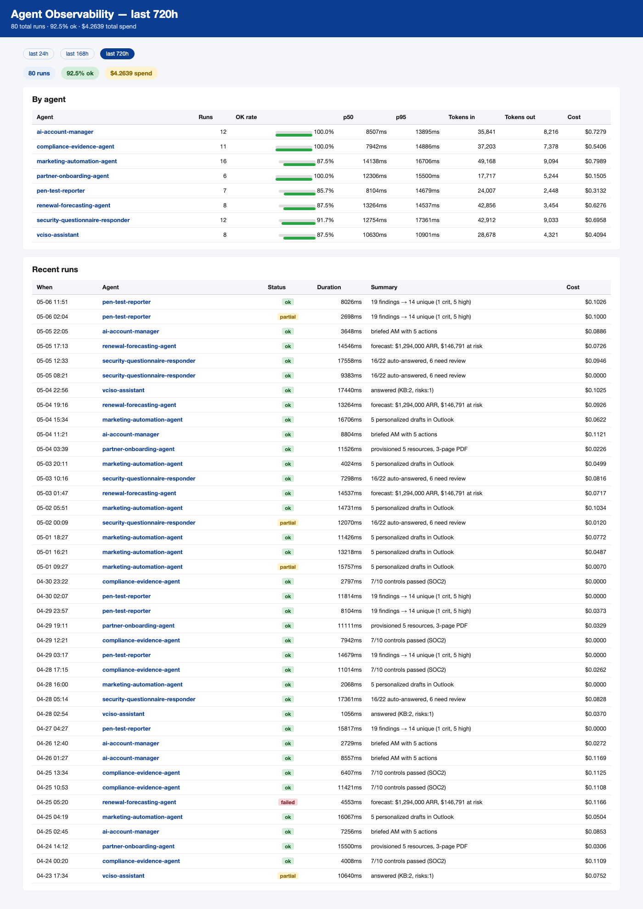
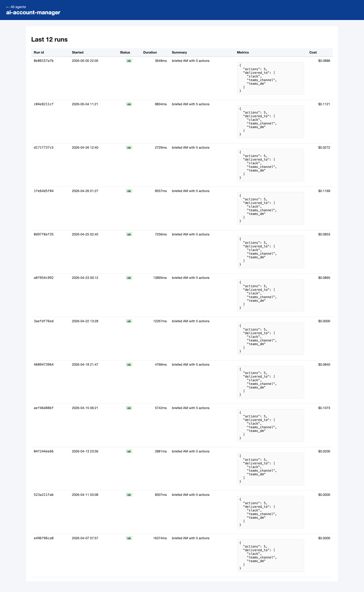

# observability-dashboard

[](https://github.com/anthonyonazure/observability-dashboard/actions/workflows/tests.yml)
[](https://www.python.org/)
[](LICENSE)

Single-pane-of-glass for the entire B2B agent fleet. One FastAPI page surfaces every agent's run history, OK rate, latency percentiles, token / cost spend, and a per-agent drilldown. Agents call `POST /v1/runs` to record themselves — no log-shipping infrastructure required.

## Why this exists

Eight agents in production is eight separate places to remember to look. The question changes from "is this one agent working?" to "is anything regressing across the fleet?" — that's a dashboard problem, not an agent problem.

## Architecture

```
              POST /v1/runs
                  │
                  ▼
          SQLite (one row per run; metrics in JSON)
                  │
                  ▼
       FastAPI + Jinja2 (dashboard.html, agent_detail.html)
                  │
                  ▼
      single page: aggregates by agent + recent runs feed
```

Agents stay decoupled — each posts its run to the dashboard endpoint at the end of `astream()`. Same endpoint works for any LangGraph / LangChain / vanilla Python agent that can `POST` JSON.

### Dashboard



### Per-agent drilldown



## Quick start

```bash
pip install -e ".[dev]"
cp .env.example .env

agentlog seed --n 80         # populate with 80 synthetic runs across all 8 agents
agentlog serve               # http://localhost:8090
```

## Hooking up your agent

```python
import httpx
from datetime import datetime, timezone

httpx.post(
    "http://your-dashboard:8090/v1/runs",
    json={
        "id": run_id,
        "agent": "partner-onboarding-agent",
        "started_at": datetime.now(timezone.utc).isoformat(),
        "duration_ms": 5421,
        "status": "ok",  # ok | partial | failed
        "summary": "provisioned 5 resources, 3-page PDF",
        "metrics": {"resources_provisioned": 5, "pdf_pages": 3},
        "cost_usd": 0.024,
        "tokens_in": 4_120,
        "tokens_out": 982,
    },
)
```

## Layout

```
src/agentlog/
├── db.py           # SQLAlchemy: AgentRun
├── seed.py         # 80 synthetic runs across the 8 agents over 30 days
├── api.py          # FastAPI: /, /agent/{agent}, /v1/runs, /health
└── cli.py          # `agentlog seed | serve`
templates/
├── dashboard.html
└── agent_detail.html
```
